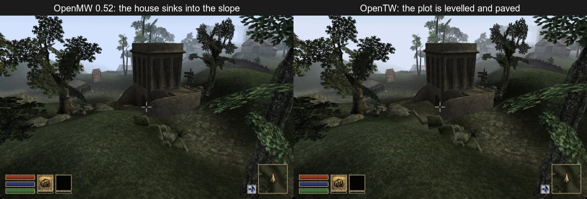
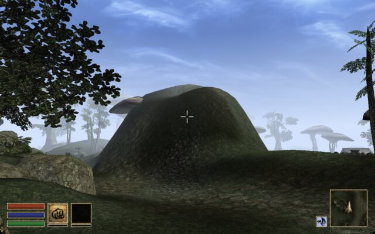

# OpenTW: Tomorrowind on a terraforming OpenMW

**Status: proof of concept.** Tomorrowind stays a plain OpenMW 0.52 Lua mod.
OpenTW is an *optional* engine: OpenMW 0.52 plus a small patch that lets Lua
change the land while the game runs. On OpenTW the mod also

- **levels and paves the ground under every building you place**: the land
  is pulled to the building's floor, blends back into the slope around it,
  and gets a ground texture (cobblestones for the storehouse, market and
  warehouse, tilled soil for farms, a dirt road for houses, dirt elsewhere);
- adds a **landscaping tool** (**L**): raise and lower the ground, level it,
  and paint it. Dig below sea level for a pond or a river, raise the sea floor
  for an island.

On stock OpenMW none of this happens: buildings stand on their pilings as
before, and **L** says the tool needs OpenTW. Saves work on both engines.





## Building OpenTW (macOS, Apple Silicon)

```sh
tools/build_opentw.sh            # clones OpenMW 0.52 RC1 into ../opentw, applies opentw/patches, builds
```

That downloads OpenMW's prebuilt macOS dependency bundle (the one its CI
uses), builds only the game (no launcher or editor, so no Qt), and leaves
`../opentw/build/OpenMW.app`. Start that instead of the normal OpenMW.app: it
reads the same `openmw.cfg`, data files and saves. The first build took about
5 minutes on a 14-core M-series Mac.

## The engine API

Global scripts get `openmw.world.terrain` (nil on stock OpenMW, which is how a
mod detects OpenTW). All positions are world units in the default
(Morrowind) worldspace; only x and y of `center` are used.

| Function | |
|---|---|
| `terrain.flatten(center, radius, height[, falloff])` | Pull the ground to `height`: fully within `radius`, fading out over `falloff` (default `radius / 2`). |
| `terrain.raise(center, radius, delta[, falloff])` | Raise the ground by `delta` (negative lowers it). |
| `terrain.paint(center, radius, texture)` | Paint every texel within `radius`. `texture` is a LTEX record id (`'Sand'`, `'AI_Grass_Cobbles'`) or texture file (`'tx_sand_01'`); unknown ones raise an error. |
| `terrain.reset()` | Undo every edit. |
| `terrain.VERSION` | `1` |

Edits are queued and applied after the current Lua update, in order, so
`core.land.getHeightAt` sees them from the next frame on. `core.land.getTextureAt`
reports painted texels.

**Edits are not saved by the engine.** Loading a game starts from the
untouched land again; the mod keeps its own list of edits in its save data
and replays it after loading (`scripts/tomorrowind/landscape.lua`). That
keeps saves loadable on stock OpenMW.

### How it works

`opentw/patches/` holds the engine change (about 770 lines on top of
`openmw-52-rc1`):

- `MWWorld::Terraformer` keeps edited copies of `LAND` records. Brushes work on
  the global vertex grid (128 units apart), so the vertices neighbouring
  cells share stay equal and no seams open. Normals and min/max heights are
  recomputed. Cells without land (open sea) can be edited too.
- `MWRender::LandManager` serves the edited copies to everything that reads
  land: rendering, physics, navmesh, `core.land`.
- After an edit, the terrain chunk caches are dropped and the views rebuilt
  (distant terrain and the plain cell grid), the collision heightfield and
  navmesh of loaded cells are swapped, and actors nearby are put back on the
  ground.
- A painted texel can use a texture from any plugin (stock land resolves all
  of a cell's textures against the plugin that defined the cell).
- Results built on background threads (terrain preloading) are only cached
  if no edit happened while they were built.

## Testing

```sh
tools/build_opentw.sh
O=../opentw/build/OpenMW.app/Contents/MacOS/openmw
# engine: heights, textures, collision, navmesh, reset and replay
FORCE_MOD_DATA=1 OPENMW=$O TEST_CONTENT=terraform.omwscripts SHOTS="16" tools/playtest.sh /tmp/tt
# the mod: a house on a slope gets level, paved ground; the tool; all of it survives save + load
FORCE_MOD_DATA=1 OPENMW=$O TEST_CONTENT=opentw.omwscripts SHOTS="14" tools/playtest.sh /tmp/ot
grep -h -E 'PASS|FAIL' /tmp/tt/stdout.log /tmp/ot/stdout.log
```

`FORCE_MOD_DATA=1` makes the playtest load this checkout's scripts even when
your `openmw.cfg` loads Tomorrowind from somewhere else (a worktree, say).
`opentw_shot.omwscripts` takes the comparison screenshot above; run it on
both engines.

## Known gaps (what a real version needs)

- **World objects don't follow the land.** Trees, rocks and the plinths of
  some building meshes keep their height, so a cut into a slope shows their
  buried bottoms, and a raised hill swallows them. Fix in Lua: move statics
  in the edited area by the height change, or let the engine report it.
- **Every edit redraws all terrain chunks.** Fine for the occasional building
  or brush stroke, but a hitch with distant terrain on. Next: drop only the
  chunks over the edited cells.
- **Replaying edits on load scales with their number.** A long game with lots
  of landscaping should save a compact snapshot (heights and textures per
  edited cell) instead of every brush stroke. That needs an engine function to
  read and write a whole cell.
- **Quadtree culling bounds** are computed once at startup, so a hill raised
  far above the original land can pop out of view at the screen edge.
- The global map, local map and `WNAM` low-res heights don't change.
- Default worldspace only; no editing of interior "exteriors" or ESM4.
- Foundation wood is still charged on slopes; on OpenTW the slope analysis
  should drop the pilings' cost.
- Builds for Windows and Linux follow the same pattern as OpenMW's CI.

## Keeping up with OpenMW

The patch touches few places (`LandManager`, `Scene::loadCell`, the terrain
caches, two Lua bindings), so rebasing it on new OpenMW releases should be
cheap. A cleaner long-term route is proposing a terrain-editing Lua API
upstream: OpenMW-CS already edits terrain live, and this patch reuses the
same mechanisms.
